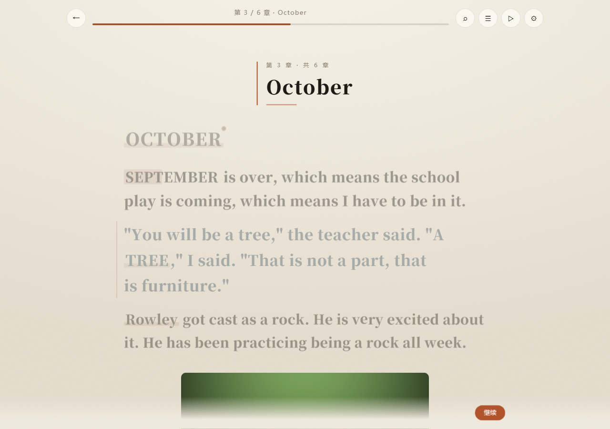

# 字流 · 互动阅读器

一个本地小说阅读器：**大部分时候它是一本正常的小说**，偶尔才有一句突然变大、一个词跳出来等你点，或者整页跳出一张卡。

字被当成人来演：台词会点头、响的句子会蹦、写着「跑」的词会真的跑起来；**一行里的字还各自一上一下地跳**，跟真的有人站在那儿一样。

点一下立刻有反应——**整块阅读面点哪儿都继续**（正文、留白、顶栏、页脚），翻屏不做平滑动画，字没显完时点一下会立刻全部出来；**读到章末直接进下一章，不弹「本章完」问你**。**点击、双击都不会选中文字**（以前点空白偶尔会选中一片字，很烦），要抄一段话就**长按**，再按住拖一下可以选更多。

也可以整本切到「互动模式」，一句一句地读，像舞台剧；或者切到 **「沉浸模式」**——一页只推进一句或一段，**最新的一段落在屏幕正中**，读过的往上走、越往上越淡，像聊天一样一句一句长出来。

**正则美化**也在设置里：自己写一条正则，命中处可以高亮 / 放大 / 发光 / 淡化，或者直接替换成别的字（只改屏幕上的显示，原文一个字不动）。

中文、英文都走同一套规则（英文按词、大写、引号；中文按字、拟声、引号）。

全程在浏览器本地完成 —— 不联网、不上传、不改动原文一个字。


---

## 快速开始

**方式一（最简单）**：双击 `index.html`（或 `打开字流.cmd`），用 Chrome / Edge 打开。

**方式二**：在本目录起一个本地服务器。

```powershell
npx serve .
# 或
python -m http.server 8080
```

打开 `http://localhost:8080`，点右上角 **「试读示例」**。想试导入，`example/` 里有 `雨停之前.epub`、`雨停之前.txt`，一个专门用来折腾解析器的 `压力测试.epub`（10 章、带图、含超长段落和空章），还有两本对照书：`短章测试.txt`（每章只有 5 行）和 `长夜行.txt`（普通长度的一章）。

**方式三（手机上最省事）**：直接打开 <https://rregjn24fw.github.io/ziliu-reader/>，同一个页面，手机上也能用。

---

## 线上地址（已经部署在 GitHub Pages）

**https://rregjn24fw.github.io/ziliu-reader/** —— 手机浏览器直接打开就能用，不用装任何东西。

这就是本仓库的静态站点：没有构建步骤，`index.html` 里的路径全是相对的（`styles.css`、`js/...`），没有 CDN、没有后端，所以放在 `/<仓库名>/` 这种子路径下也能正常跑。

**改完怎么更新**：在仓库里改文件（网页上传或 `git push`），Pages 几十秒后自动重建，刷新页面就是新的。

**想自己再建一个**：把 `ziliu/` 里的**内容**放到新仓库根目录（根目录能直接看到 `index.html`），然后仓库 → **Settings → Pages** → Source 选 *Deploy from a branch* → Branch `main`、Folder `/ (root)` → Save，网址就是 `https://<用户名>.github.io/<仓库名>/`。

- 免费账户的 Pages 只对 **public** 仓库开放
- 仓库根目录必须直接有 `index.html`；如果整个 `ziliu` 文件夹原样放进去，网址要带 `/ziliu/`，根目录会 404
- 根目录的 `.nojekyll` 让 GitHub 跳过 Jekyll 处理，别删
- 导入的书和进度存在**这台设备的浏览器里**（IndexedDB / localStorage），不跨设备同步；换台手机就是空书架，重新导入即可（线上实测过：同一浏览器关掉重开，书和进度都还在）
- 国内访问 `github.io` 偶尔会慢或者抽风；同一份文件拖进 **Cloudflare Pages / Netlify**（构建命令留空、输出目录 `/`）也能得到一样的站点
- 整份目录约 16MB（大头是 `example/Wimpy 风格.epub` 3.3MB 和 `tools/` 里的说明截图），Pages 的单站限制是 1GB，放得下

---

## 三种模式

设置 → **阅读方式**：

| 模式 | 是什么样的 |
| --- | --- |
| **阅读**（默认） | 整章铺开、滚动着读。字号基本是正常的，只有真正"响"的句子才会偶尔放大一次；**每段一个跳词、至少一个字在动** |
| **互动** | 舞台式：一句一停 / 一段一停 / 整章铺开三种粒度，字号随情绪剧烈起伏，新句子在底部往上堆 |
| **沉浸** | 互动小说式：一页只推进一句或一段，**最新的一块落在屏幕正中**，读过的被推到上方、越往上越淡 |

### 沉浸模式（设置 → 阅读方式 → 沉浸）

- **一页读多少**：一句 / 一段（默认一段）。点、空格都是下一块；往下滚也是下一块，但先往上滚回看旧段落时，得滚回当前这一块再往下才算翻页。
- **上面留几段**：0–4 段，默认 2。0 = 屏幕上只剩当前这一页；1–4 就是互动小说的"对话历史"，越往上越淡。
- 当前这块永远在屏幕正中；已经读过的段落会平滑地往上走，不会整章一起铺开压下来。
- 进度条、目录、卡页、章末自动续读、搜索跳转在沉浸模式里照常工作；退回一句时如果那一页已经被裁掉，会重新铺页而不是空屏。


切到互动模式后，还能再选粒度：

- **逐句**：一句一停，短句逐字显影
- **每段**：一段一停
- **整章**：一次铺满，滚动读（但没有阅读模式那种克制）


---

## 读完一章，直接接着读下一章

**没有「本章完」确认**：读到最后一屏，点一下 / 按空格 / 滚到底再往下滚，就直接进下一章——像普通小说阅读器一样，中间不弹任何东西。

- 换章那一下，新章节的标题卡会落下来、底下一条线扫开，正文上浮淡入一下；屏幕下方飘一行「第 N 章 · 标题」，不拦任何点击
- **自动播放也会跨章继续**：不用再点一次，也不会在章末停下来问你
- **最后一章读完了才停在「全书完」**：目录 / 重读本章 / 回到书架，点空白就收起
- 想回头：按 `←`；在章首再按一次，就退到**上一章的末尾**，像顺着书页往回翻
- 空章会被跳过，不会翻到一页空白；跳章、目录、进度条都照旧


---

## 自动播放：点一下 ▷，它自己往下走

点右上角的 ▷（或按 `A`），文字就自己往前；**再点一下 ❚❚（或再按一次 `A`）才停**，不用一直点屏幕。

- **互动 / 沉浸模式**：按设置里的「间隔」一句一句往下走；短句的逐字显影自然走完以后，下一句照常来，不会卡在半路（以前逐字显影结束后第一次推进会被当成「补全显影」吃掉，自动播放走一句就悄悄停了）
- **阅读模式**：每隔一个间隔，把下一句推到屏幕顶上，像有人替你往下推纸；一截一截看得见地走，不再以 8px/s 偷偷爬
- **跨章不停**：读到章末直接进下一章，最后一章读完才停在「全书完」
- **打开目录 / 设置 / 回声卡只是暂停**：关掉就自己接着走；改字号、换模式、调间隔也一样接着走
- **你一动，它就让位**：滚一下滚轮、手指拖一下、点一下屏幕、拖进度条，正在推的那一下立刻停下；按 `←` 会直接关掉自动播放
- 间隔在 设置 → 自动播放间隔 里调（1.0–6.0 秒，越小越快）

---

## 读法：只在设置里定（设置 → 读法）

读到一半**不会**弹「这一刻，你想怎么读」来打断你。想要哪种读法，进设置定一次，之后一直按它读：

- **正常** —— 原文原来的样子
- **凑近** —— 字号放大 18%，像把头凑近书页
- **退后** —— 字号收 14%，把环境推远一点
- **安静** —— 不跳词、不逐字动，只留字（只想读的时候用）

点一下就生效，读到哪儿还是哪儿；正文里没有任何弹层，也不会再冒出来问你。


---

## 整页大弹窗（设置 → 整页大弹窗）

读到某处，页面一暗，**整页跳出一张卡**：一个词（附它在别处出现的句子），或者一句被抽出来放大的话。点一下才继续。

卡上永远有：一句「读到 xx%」的进度、一个或大或小的词、一条短横线、一句话、底下「轻点任意处继续」；词卡还会多一条「别处：……」的回声。

### 隔多少句、隔多少段，你自己定

设置 → 整页大弹窗：

- **开 / 关** —— 关掉就一张都不弹
- **隔几句来一张** —— 一根滑杆，按句 **2~30**、按段 **1~15**，拖到哪儿就是哪儿；默认每 6 句一张
- **按句 / 按段** —— 句 = 一句话一张；段 = 一整段读完才弹
- **抽后文 / 抽前文** —— 卡片上那句是**接下来要读的**（默认，像个小预告），还是**刚读过的**
- 底下直接写着「本章 2 张 · 再读 4 句就有下一张」，还有一颗 **「现在就弹一张看看」**：不用等，拿屏幕正中间那句现做一张卡

段落是引擎里真数出来的（每个节拍记着自己属于第几段），不是按行数估的。

**零头会带到下一章**：这一章剩下的句数记着，下一章接着数——所以每章只有几行的书，读两三章也会遇到一张，不会因为"一章不够 6 句"就永远没有卡。

卡在正文里只留一道极细的虚线痕迹；用"越线检测"判断——只要视窗中线越过它，就弹出来，**翻得再快也不会漏**。读到章尾还有卡没弹过，会先弹卡，弹完再直接进下一章；一屏就读完的短章也一样（点一下"继续"先把卡弹出来）。互动模式里走到卡页会直接弹，不用滚。


---

## 拟人动作（设置 → 拟人动作）

动的是**句子里单独的几个字**，不是整句，也不是整行：

- **每段至少有一个字在动**：引擎给每段标了"段首行"，这一行永远不会安静；一页里每一段都找得到动点
- **每行挑 1~3 个字**（按行长和随机种子），动作有 **15 种**：上下跳 / 歪头 / 左右摆 / 脉冲 / 蹦一下 / 发抖 / 张望 / 台词里的字会"开口" / 漂移 / 浮动 / 翻面 / 发光 / 摆荡 / 数字弹一下 / 标点敲一下；每个字的幅度、时长、起始相位都不一样，近看就是一群人各自动各自的
- 段首行之外，**12% 的行会安静下来**；35% 的字动一下就停住——不是所有字一起机械地跳
- **整行本身一动不动**：没有整句平移，也没有整块波浪；只有那些被挑中的单字在动（入场、换章那一下除外）
- **逐字显影的那几行也有字在动**：字一个个显出来的同时，其中一两个已经在跳了
- **词义动作**：写着「跑」「抖」「冷」「大」「小」「喊」「笑」「哭」的词，自己真的跑、抖、发凉、涨大、缩小、喊、笑、哭；英文 `jump / fly / fell / shouted / tiny` 这些也认
- 只有滚进眼睛里的那几行才动，滚走的不占 CPU；卡页上的大字按块起伏，这次也换成了好几种动作（起伏 / 点头 / 蹦 / 摆 / 发光）

分 **关 / 轻 / 活**（默认 **活**）。开「减少动态效果」时自动静止。


---

## 正则美化（设置 → 正则美化）

自己写正则，**只改屏幕上显示的字**，原文、搜索、回声、存档一个字都不动。

- **样式**：高亮 / 放大 / 发光 / 淡化。命中处包一层 `.rx`，逐字活字、跳词、搜索高亮都照常工作。
- **替换**：把命中的字在显示时换成别的（支持 `$1`…`$9`、`$&`；**留空 = 删掉**）。
- **写法**：直接写正则，默认不分大小写（`gi`）；写成 `/…/gi` 就按你写的开关来（没写 `g` 会自动补）。
- **先试跑**：输入框下面实时显示「命中 N 处 · …前后文… ⇒ 替换结果」，加之前就知道会发生什么。
- **随时能撤**：每条规则一个开关、一个删除；最多 16 条；坏正则不会生效，行上会写清楚错在哪儿。
- **例子**：`「[^」]+」` 发光 → 台词会亮；`…{2,}` → `……` → 把省略号统一成中文省略号；`[,;]` → `，` → 半角标点变全角。

> 别写 `(a+)+` 这种嵌套量词——它能把页面卡死，所以被直接拦掉了。规则只作用于正文，卡页 / 回声卡 / 搜索摘要仍显示原文。


---

## 点击立刻有反应（电脑端也是）

这是特意修过的：早版本里翻页用的是平滑滚动，**连点第二下会被前一次滚动吃掉**，看起来像没反应。

现在：

- **整块阅读面都能点**：正文、左右留白、页脚空白、顶栏空白，点哪儿都往下翻一屏；只有真正的控件（按钮、顶部进度条、章节名、抽屉、浮层）不接管
- **读到章末直接进下一章**：不弹「本章完」、不等确认；滚到底再往下滚、点一下、按空格都算继续
- **点击、双击、手抖拖一下都不会选中文字**——正文默认 `user-select: none`，`selectstart` 也拦掉了；要选字必须**长按**（约 0.46 秒）
- **长按选中的是一条"文字条"**（中文 2~10 个字、英文一个词，尽量是完整的名字/短语），按住再拖可以选更多；选中后浮出「⟲ 回声」按钮，`Ctrl+C` 直接复制
- 选完点一下：**收掉选区的同时继续往下读**，不会白吞这一下
- 阅读模式翻屏**不做平滑动画**，点一下位置立刻变
- 字还没显示完时点一下，**立刻把整句补全**（不是等它慢慢显示完，也不是被吞掉）
- 逐字显影整句控制在 ~0.2 秒内，再快读也跟得上
- 卡页 / 回声卡 / 「全书完」打开时，点击只会关掉它，不会误翻页；再点一下才算翻页

鼠标用户还有：细滚动条（以前藏起来，根本看不出翻到哪儿了）、更宽的正文栏、顶栏和页脚跟正文栏对齐、卡片和提示的悬浮反馈。


---

## 进度条：拖一下就跳

顶部那条细线可以点、可以拖，直接跳到本章任意位置；拖动时浮出 `52% · 第 6 / 11 段`。


---

## 图片

EPUB 里的插图会按原顺序显示出来，而不是被丢掉。


支持三种常见写法：

- ``（最常见）
- `<svg><image xlink:href="../Images/cover.jpg"/></svg>`（很多排版软件、封面页都这么导出）
- `<image href="...">`（EPUB3 写法）

路径大小写写错也能找回来（`../images/Fig1.PNG` → `Images/fig1.png`），包里没有的图会留一句「图片未包含」而不是整章崩掉。

图片以 data URL 存进本地 IndexedDB；超过 700KB 的图会先缩到 1400px 宽再转 WebP，单张上限 12MB、全书上限 64MB。（一整本 326 张插图的英文原版书，导进来约 9MB，图全部能显示。）

---

## 互动（设置 → 互动密度）

**每一段至少有一个词会"跳出来"**，密度只决定长段里再多几个：**少** = 每段一个；**中** = 长段里最多两个；**多** = 长段里最多三个（同一段里两个词之间隔几拍，不会挤在一起）。默认「少」。

跳出来的词有三种样子，同一个词永远是同一种：**红点**（一闪一闪）、**扫光**（下划线上一道光扫过）、**呼吸**（底色轻轻起伏）；刚滚进视野那一下，这一段唯一的跳词还会亮一下，告诉你动点在哪。

**跳词 · 回声** —— 点带下划波纹的词，从全书里找出它出现的另一句：

> 巷子 —— 全书出现 3 次
> 「巷子尽头蹲着一只黑猫，眼睛亮得像两颗钉子」 —— 第二章

- 跳出来的不是随手的两个字，而是 **2~10 个字的"文字条"**，优先保住完整的名字/短语（「马尔福家」不会只剩「福家」，长名字取偶数长度，至少留一个字在条外）。
- 整条只在书里出现一次时，会自动**退到更短的核心词**再找一遍，卡上写明「从「…」里找的」，不会让你点了个死胡同。


**长按回声** —— **长按**一段文字（点击、双击都不选），选中那一小块（同样是 2~10 个字的文字条），浮出「⟲ 回声」按钮查它的全部出处；`Ctrl+C` 直接复制。


**回声簿** —— 点开过的词都记在里面。

---

## 搜索全书（`Ctrl+F` 或 `/`）

- **普通 / 正则**两种模式；普通模式把输入当字面量，正则模式可以写 `雨.{0,2}停`、`^「.+」$`。
- 搜完整本书，列出命中句和章号，**点一条就跳过去**，那句会用 `<mark>` 高亮并闪一下。
- `Enter` 下一处、`Shift+Enter` 上一处、`Esc` 关掉；最多列 400 处，右下角写着耗时。
- 正则写错会在面板上报错，并保留上一次的结果；零宽正则（`a*`、`^`）不会卡死。


---

## 英文书

英文不再"没有互动"。断句按 `. ! ?`（`Mr.` `Dr.` `3.5` 不会切错），台词认 `"..."` 和 `"..."`，跳词从这些地方挑：

- 全大写词（`ZOO-WEE MAMA` 这种）
- 拟声词（BANG / CRASH / THUD …）
- 引号里的短语
- 本章反复出现的实词（出现 3 次以上）

阅读模式照样克制：英文实测 **83%~93% 的句子是正常字号**，只有真正"响"的那句才放大。



---

## 台词与旁白

台词**另有一种字色** + 顶在一条赭石色竖线上；旁白退成灰、不带竖线。左边缘始终对齐。

字色跟着主题走（`--dlg`）：纸 = 墨蓝、夜 = 淡蓝、墨 = 青。

---

## 章节跳转


点顶部章节名或 **☰** 打开目录：全部章节、每章已读百分比，点哪章跳哪章；顶部 `‹` `›` 翻章；键盘 `M` / `[` / `]`。

---

## 功能

- **导入** `.txt`（UTF-8 / GB18030 / UTF-16 / Big5 自动识别）与 `.epub`（自写 ZIP 解析，无第三方库）
- **中英文都行**：英文按词/大写/引号挑词，中文按字/拟声/引号挑词
- **自动分章**：识别「第 X 章 / 楔子 / 番外 / Chapter N / SEPTEMBER」这类标题，认不出按字数切块
- **EPUB 章节名**从 nav / toc.ncx 读，读不到用 `<h1>`
- **短章节不会被吞**：只要这一章有字或有图就会保留（之前 <20 字会被当封面页丢掉，这是老版本的 bug）
- **整页大弹窗**：读到某处整页跳出一张卡（词 / 句），点一下继续；**间隔自己定**（按句 2~30，按段 1~15），卡片抽后文还是前文也自己定，零头跨章结转
- **三种模式**：阅读（整章滚动）/ 互动（逐句、每段、整章）/ 沉浸（一页一句或一段，最新一块在正中，旧句往上淡出，留几段可调）
- **读完一章直接续读**：章末不弹确认，点、空格、滚到底都直接进下一章；自动播放（逐句 / 沉浸 / 阅读三种走法）跨章不断，最后一章才停在「全书完」
- **每一段都有一个动点**：引擎给每段标段首行，至少一个可点的跳词 + 至少一个在动的字；跳词 3 种样子、活字 15 种动作、入场 4 种、卡页大字 5 种
- **拟人动作**：每行挑 1~3 个单独的字，各有各的动作/幅度/相位，整行本身不动；动作词演自己的意思
- **正则美化**：自己加正则，命中处高亮 / 放大 / 发光 / 淡化或替换成别的字，只改显示不改原文；实时试跑、开关、删除
- **搜索全书**：`Ctrl+F` 或 `/`，普通 / 正则，命中列表 + 跳转 + 高亮，Enter / Shift+Enter 上下条
- **点击零等待**：整块阅读面点哪儿都继续（含顶栏、页脚、留白），翻屏不做平滑滚动，字没显完时点一下立刻补全；点击/双击都不选字，长按才选；章末不确认，直接下一章
- **书架**：字数（英文显示词数）、章节数、图数、进度、删除；进度自动记住
- **三套主题**：纸 / 夜 / 墨
- **自动播放**：点 ▷（或 `A`）就自己往下走——互动 / 沉浸模式按间隔一句一句走，阅读模式按间隔把下一句推到顶上；跨章不停，打开设置只是暂停；滚轮 / 点击 / 拖进度条 / `←` 会让它让位或停下

### 快捷键

| 键 | 作用 |
| --- | --- |
| `空格` `→` `↓` `Enter` | 继续 / 往下翻一屏 / 沉浸模式下一块 |
| `←` `Backspace` | 退回；在章首再按一次，回到上一章的末尾 |
| `[` `]` | 上一章 / 下一章 |
| `M` | 目录 |
| `A` | 自动播放 |
| `Ctrl+F` / `/` | 搜索全书 |
| `Enter` / `Shift+Enter` | 搜索里下一处 / 上一处 |
| `Esc` | 关闭浮层 / 设置 / 搜索 |

---

## 文件结构

```
index.html            页面骨架
styles.css            全部样式（三套主题走 CSS 变量）
js/zip.js             极简 ZIP 读取（DecompressionStream('deflate-raw')）
js/importers.js       TXT 编码探测 + 分章；EPUB 解包 + 图片 → data URL
js/engine.js          互动规则引擎（纯函数，无 DOM，可单测）
js/sample.js          内置示例《雨停之前》
js/store.js           IndexedDB 存书与进度，失败降级到内存
js/ui.js              界面与交互
example/              示例 txt / epub（雨停之前、压力测试、短章测试、长夜行、Wimpy 风格）
tools/                生成示例、自检、端到端测试、桌面点击测试、EPUB 体检、截图脚本
```

### 想改规则？

- 阅读模式的"偶尔放大" → `engine.js` 的 `makeRestrainedScale()`
- 互动模式的字号波动 → `computeScale()`
- 一段/一句怎么切 → `buildParagraphBeats()` / `buildSentenceBeats()`
- 什么词跳出来 → `pickCandidate()`（英文走 `pickLatin()`）；每段一个打底、密度决定长段里再多几个 → `markQuota()` + `applyMarks()` 里的段落兜底轮（`pickFallback()`）
- 每段的「段首行」怎么标 → `markLeads()`（界面靠它保证这一段有字在动）
- 卡页出现在哪、显示什么 → `insertGatesEvery()` / `makeGate()` / `quoteOf()`（挑词时跳过虚词：`gateWordOk()`）
- 隔多少句（段）一张 → `ui.js` 的 `planGates()` 把设置交给 `insertGatesEvery()`，零头存在 `S.gateCarry`
- 卡片的措辞与滑杆 → `ui.js` 的 `gateSettingsHTML()`
- 短章兜底、章尾补弹 → `ui.js` 的 `tryLooseGate()`
- 点哪儿算"继续" → `ui.js` 里 `D.reader` 的那个 click 处理
- 长按选字 → `ui.js` 的 `pressDown / beginSelect / wordSpanAt`（`PRESS_MS` 是长按时长，`SEL_PUNCT` 决定不选哪些标点）
- 文字条多长、怎么保名字 → `engine.js` 的 `expandSpan()`（`SPAN_MIN / SPAN_MAX`、`CN_FUNC`、`cjkRun()`）
- 章节读完后怎么走 → `ui.js` 的 `autoNext()`（换章、跳空章、续自动播放）与 `showBookEnd()`（全书完）；往回退是 `backToPrevChapter()`
- 自动播放怎么走 → `ui.js` 的 `toggleAuto()` / `setAuto()` / `resumeAuto()`（一个状态两种走法）；阅读模式推纸在 `startAutoScroll()` / `autoScrollTick()` / `nextScrollTop()`；逐句模式在 `scheduleAuto()`；「间隔」= `autoSpeed()`
- 活字：哪几个字在动、怎么动 → `ui.js` 的 `pickZg()` / `ZG_MOVES` / `zgSeed()`；每段必有一个靠 `b.lead`；幅度与相位在 `styles.css` 的 `zg-*` 关键帧
- 跳词的样子（红点 / 扫光 / 呼吸）→ `ui.js` 的 `kwStyle()`；卡页大字动作 → `waveHTML()` + `.wv[data-m]`
- 什么词演什么动作 → `engine.js` 的 `VERB_ACT` / `EN_VERB`（`verbFor()`）
- 动作幅度与时长 → `styles.css` 的 `--amp`、`--ph`、`wv-*`、`v-*` 关键帧
- 回声退让（整条找不到就退到更短的词）→ `engine.js` 的 `echoKeys()`；卡上的「从…里找的」在 `ui.js` 的 `paintEcho()`
- 沉浸模式排版 → `ui.js` 的 `arrangeImmersive()` / `centerImmersive()`；留在上面的段数 = 设置里的 `stageKeep`（0~4）
- 正则美化 → `engine.js` 的 `compileRules()` / `prepareLine()` / `rulePreview()`；设置面板在 `ui.js` 的 `ruleSettingsHTML()`，正文套样式在 `inlineHTML()`
- 全文 / 正则搜索 → `engine.js` 的 `compileQuery()` / `searchText()` / `searchBook()`；跳转与高亮在 `ui.js` 的 `gotoHit()` / `repaintBeat()`
- 台词颜色 → `styles.css` 每个主题里的 `--dlg`
- 台词判定 → `beatStyle()`
- 视觉 → `styles.css` 的 `:root` 与 `body[data-theme]`

---

## 测试

```bash
node tools/selftest.mjs          # 引擎 + 规则自检（73 项：断句/挑词/文字条/每段一个跳词/回声退让/卡页零头/正则规则/搜索/词义动作/ZIP）
node tools/make-example-epub.mjs # 重新生成示例书
node tools/stress-epub.mjs       # 生成压力测试 EPUB（10 章 · 有图 · 有超长段落）
node tools/wimpy-epub.mjs        # 生成英文插图测试书（svg 包图、路径大小写写错、3MB 大图）
node tools/inspect-epub.mjs x.epub  # 看清一本 EPUB 的骨架：图片到底是怎么被引用的
```

真实浏览器里跑的四套：

```powershell
$env:PORT = 8940
Start-Process node "tools/serve.mjs"

# 1) 端到端（139 项）：导入、跳词、每段一个动点、长按选字、逐字、目录、进度条、粒度、三种模式、沉浸居中与渐隐、读法（正常/凑近/安静）、章末自动续读（三种模式 + 滚到底）、全书完、章首回退、卡页间隔、拟人与字跳动（含动作种类）、正则美化（增删/试跑/替换/非法）、全文与正则搜索、台词配色、点击时延、点空白继续、短章有卡、自动播放（逐句不停 / 设置里暂停再接着走 / 逐字走完不吞点击 / 阅读模式推纸 / 跨章不停）
node tools/run-page.mjs 8940

# 2) 桌面端真鼠标（15 项）：八个位置点空白都能翻页、章末自动进下一章（不弹确认）、长章/短章都弹得出卡、点击/双击/手抖拖都不选字、长按才选、选完点一下继续、真键盘 Ctrl+F 搜索、沉浸模式真键盘推进后仍居中、真鼠标点 ▷ 自动播放会自己走且跨章不停
node tools/desktop-test.mjs
#    换窗口尺寸：$env:W=1366; $env:H=768

# 3) 章节跳转压力测试：10 章 × 两种模式逐个跳，检查有没有空章/崩溃/丢图
node tools/chapter-test.mjs "example/压力测试.epub"

# 4) 某本 EPUB 的专项检查：解析结果、每章图片是否真的加载出来、卡页、拟人动作
node tools/epub-check.mjs "example/Wimpy 风格.epub" --shot tools/shot-en
```

`example/短章测试.txt`（每章只有 5 行）和 `example/长夜行.txt`（普通长度的一章）是给桌面测试用的两本对照书。

---

## 已知限制

- **EPUB**：不支持 DRM 加密、ZIP64 打包的书
- **EPUB 图片**：单张 > 12MB、总量 > 64MB 的部分会跳过；正文完全没引用图片的书，会把包里的图自动收拢成一章（最多 24 张）
- **`file://` 打开时**：部分浏览器禁止 IndexedDB / localStorage，书只存在内存里，刷新要重新导入（界面会提示）
- **每段一个动点**：只有 1 个字、或者整段都是标点的段落，造不出 2~10 字的词，只能靠那一个字/标点自己动；这类段落不硬造词
- **读法「安静」**：不跳词、字也不动，只留字——这是唯一会关掉"每段一个动点"的开关（还有「跳出关键词」「拟人动作」两个设置）
- **章末不停**：默认就是读完一章直接进下一章，没有"停在章末"的开关；想回头看一眼用 `←`（章首再按回到上一章末尾），想跳章用目录 / `[` `]`
- **自动播放的间隔**：一个滑块管两种走法——逐句 / 沉浸是"每 N 秒一句"，阅读模式是"每 N 秒往下推一句"，所以同样的 2.6 秒在阅读模式里会走得比逐句更快一些；觉得快就把间隔调大
- **正则美化**：只改屏幕上的显示，不写回原书；替换会把跳词/搜索高亮的位置跟着词重新映射，词被替换掉时那一个标记会消失
- **正则的复杂度**：嵌套量词（`(a+)+`）被直接拦掉，超长 / 写错的正则只报错不生效；但自己写一条真正会造成回溯爆炸的规则仍可能拖慢页面（删除那一行即可恢复）
- **不做 AI**：所有互动都是本地规则，零成本、零延迟、完全离线

---

## 下一步可以加

- [ ] 打包成 DSH 客户端插件，挂在 DSH GUI 里
- [ ] 给角色配色：识别「××说」，不同角色的台词用不同竖线颜色
- [ ] 图片点击放大（lightbox）
- [ ] 卡页加"插图卡"：整页显示一张插图，而不是只在正文里排着
- [ ] 回声簿导出
